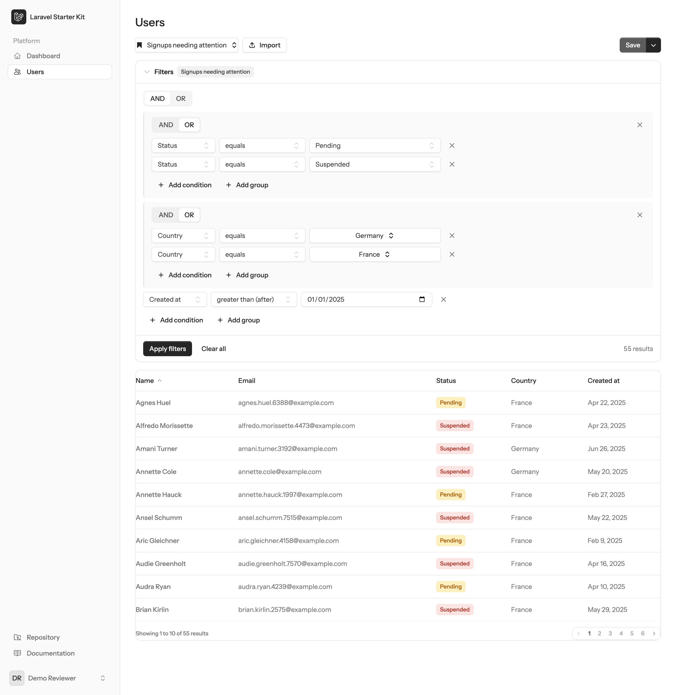
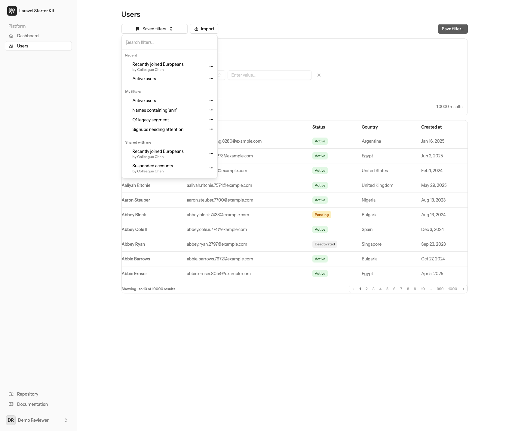
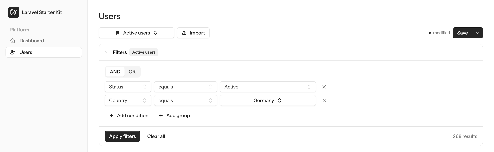
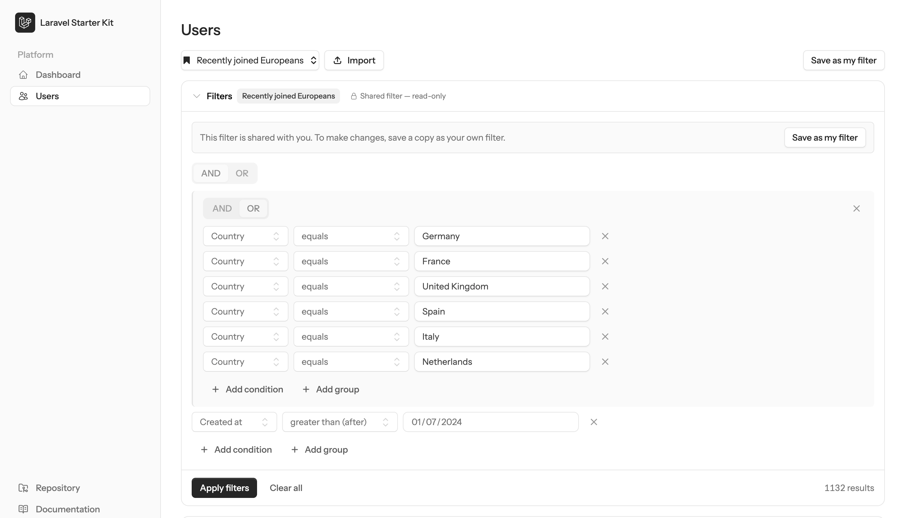
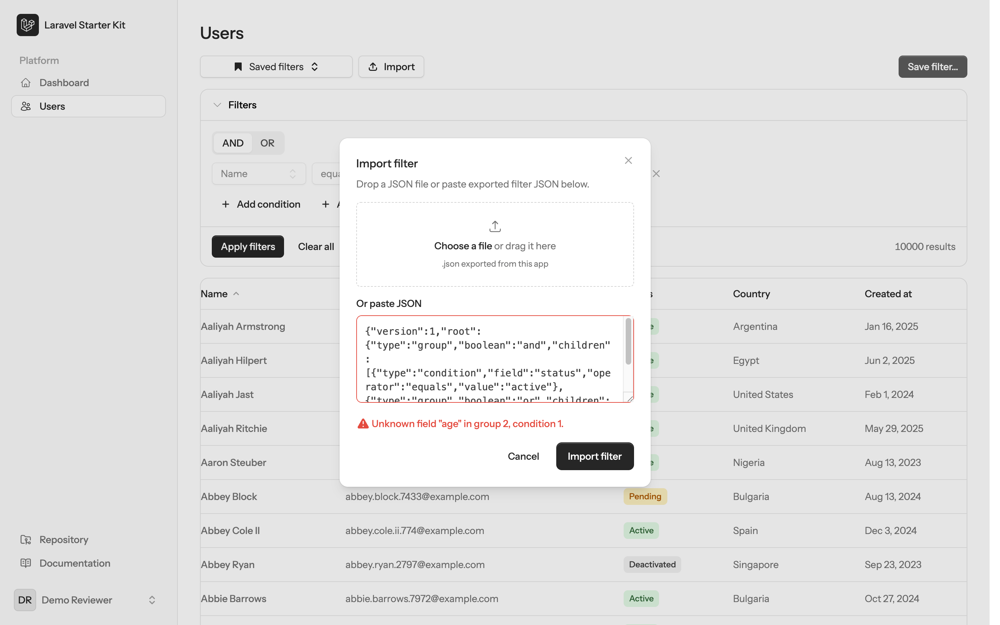
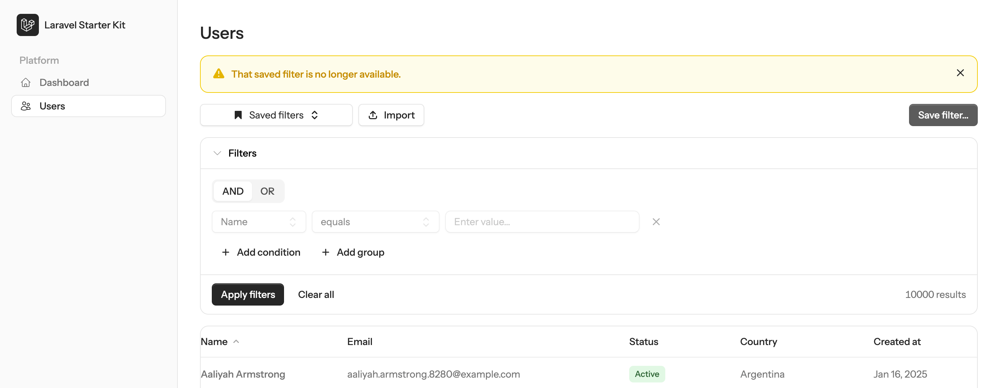

# Saved Filters — Challenge 4

Reusable, nameable, **nested AND/OR filters** over a users directory. Build a filter tree in the
browser, preview how many users it matches as you type, apply it to the table, then **save it,
share it, export/import it, and pick it back up from your recent filters**. Everything is server-side
Livewire — the filter tree, its live preview count, and the results table all run through one query
pipeline, so what you preview is exactly what you get.

**Stack:** Laravel 13 · PHP 8.5 · Livewire 4 · Flux UI (free) 2 · Tailwind 4 · PostgreSQL 18 · Pest 4 · Larastan (level 8)



---

## Quick start

**Requirements:** PHP 8.5 · PostgreSQL (the `pg_trgm` extension is created automatically by the
migrations, so the database role needs permission to `CREATE EXTENSION` — a Herd `root` superuser
has it) · Node 20+.

```bash
# 1. PHP + JS dependencies
composer install
npm install && npm run build

# 2. Environment
cp .env.example .env
php artisan key:generate

# 3. Databases — one for the app, one for the test suite.
#    (Herd's psql lives under a path with a space, so it is quoted.)
"/Users/you/Library/Application Support/Herd/bin/psql" -h 127.0.0.1 -U root -d postgres \
  -c 'CREATE DATABASE "custom-filters";' \
  -c 'CREATE DATABASE "custom-filters-test";'

# 4. Schema + the full demo dataset (10,000 users, demo accounts, seven saved filters)
php artisan migrate --seed
```

Then open **http://filters-demo.test/users** (Laravel Herd serves the site automatically), or run
`php artisan serve` and visit `http://127.0.0.1:8000/users`. Log in with a demo account below.

`.env.example` already points at the Herd PostgreSQL defaults (`pgsql`, `127.0.0.1:5432`, user `root`,
empty password, database `custom-filters`); the test suite uses `custom-filters-test`.

---

## Demo accounts

Both accounts use the password **`password`**.

| Email | What it shows |
|---|---|
| **demo@example.com** | The reviewer seat. Owns four saved filters: **Active users** (single condition), **Signups needing attention** (the depth-3 showpiece), **Names containing 'ann'** (the trigram-index example), and **Q1 legacy segment** (deliberately *stale* — see the tour). Two of three recent-filter slots are pre-warmed. |
| **colleague@example.com** | A second user. Owns two **shared** filters — **Recently joined Europeans** and **Suspended accounts** — which demo@ sees read-only and can fork, plus one **private** filter (**Colleague's private notes**) that demo@ can never see. |

---

## Guided tour

Every ask in the challenge, mapped to a step. All counts below are exact — the seed is deterministic.

1. **The directory.** `/users` lists **10,000** users, 10 per page, with sortable Name / Email /
   Status / Country / Created-at headers. Unfiltered, the footer reads *10000 results*.

2. **Build a nested filter.** Add conditions and sub-groups, toggling each group between **AND** and
   **OR**. Field choices constrain the operators (e.g. `created_at` offers only *greater than* /
   *less than*; `status` only *equals* / *not equals*). The quickest way to see the shape is to open
   the **Saved filters** menu and load **Signups needing attention**, which is exactly
   `(status = pending OR status = suspended) AND (country = DE OR country = FR) AND created_at > 2025-01-01`.

3. **Preview count, live.** As you edit, the count next to *Apply filters* recomputes on every
   change (debounced while you type) through the same pipeline as the table. The filter above previews
   **55 results**; blank conditions are greyed out and ignored, so a half-typed row never changes the
   count.

4. **Apply.** *Apply filters* runs the tree against the table — the 55 matches appear, pagination
   resets to page 1, and the URL gains `?filter={id}` while a clean saved filter is applied.

5. **Save.** *Save filter…* opens a dialog for a name and a share toggle. Names are unique per owner
   (case-insensitive); a collision is rejected with *"You already have a filter with this name."*

6. **The saved-filters menu.** A searchable popover with three sections — **Recent** (max 3),
   **My filters**, and **Shared with me** (each shared filter labelled *by {owner}*). Typing filters
   the list in place.

   

   Load a few to see the counts: **Active users** → **7,026**; **Suspended accounts** → **998**;
   **Names containing 'ann'** → **547**.

7. **Dirty state.** Load a saved filter, then change anything in the builder. A **modified** dot
   appears, the split **Save / Save as new…** button lights up, and `?filter` drops from the URL —
   the applied table hasn't changed until you Apply again.

   

8. **Share & fork.** As demo@, load colleague@'s shared **Recently joined Europeans** (**1,132**
   results). The builder renders **read-only** with a banner and a **Save as my filter** button that
   forks it into your own private copy (prefilled *"Recently joined Europeans (mine)"*).

   

9. **Export / import round-trip.** Any filter's action menu has **Export JSON**, which downloads the
   `{version, root}` envelope (plus its name). **Import** accepts a dropped file or pasted JSON and
   loads it as an *unsaved* draft — save it to keep it. Malformed input is rejected with a single,
   positional message, e.g. *Unknown field "age" in group 2, condition 1.*

   

10. **Recent filters.** Applying a clean filter, saving, or loading one pushes it onto **Recent**
    (top 3). demo@ starts with two entries pre-warmed (*Active users*, *Recently joined Europeans*);
    your first apply visibly fills the third slot. Editing a filter into a dirty draft and applying
    that does **not** count.

11. **A stale saved filter.** **Q1 legacy segment** has a stored definition that no longer validates.
    It stays listed so its owner can inspect or delete it, but loading it refuses with a toast rather
    than silently doing nothing — *"'Q1 legacy segment' can't be applied — it's no longer valid."*

12. **A dead link.** Visit `/users?filter=00000000000000000000000000` (a bogus id). Instead of
    failing, the page renders **unfiltered** and shows a dismissable banner: *"That saved filter is no
    longer available."* Foreign and unshared ids share this same non-leaking message.

    

---

## Performance

At 10,000 rows the text operators (`contains`, `starts_with`, …) run case-insensitively as `ILIKE`
and are served by **GIN trigram indexes on the bare `name` and `email` columns**. You can prove the
planner uses them — paste this into psql (Herd's binary lives under a path with a space, so it is
quoted):

```bash
"/Users/you/Library/Application Support/Herd/bin/psql" -h 127.0.0.1 -U root -d custom-filters \
  -c "EXPLAIN ANALYZE SELECT * FROM users WHERE name ILIKE '%ann%';"
```

```text
 Bitmap Heap Scan on users  (cost=18.09..280.67 rows=1006 width=235) (actual rows=547 loops=1)
   Recheck Cond: ((name)::text ~~* '%ann%'::text)
   Heap Blocks: exact=233
   ->  Bitmap Index Scan on users_name_trgm_index  (cost=0.00..17.84 rows=1006 width=0) (actual rows=547 loops=1)
         Index Cond: ((name)::text ~~* '%ann%'::text)
 Execution Time: ~1.5 ms
```

The `Bitmap Index Scan on users_name_trgm_index` is the point: a substring `ILIKE` at 10k rows hits
the trigram index rather than sequentially scanning every user. The index is on the **bare** column
(not `lower(name)`) because `ILIKE` will not use a `lower()` trigram index, and pg_trgm already
matches case-insensitively.

Dates get the same treatment: `created_at` comparisons cast to a UTC day, so there's a matching
expression index `users_created_at_date_index` on `((created_at)::date)` that makes the cast
indexable, while the plain btree on `created_at` still serves `ORDER BY created_at`.

---

## Testing

```bash
# First time only — the browser layer drives a real Chromium via Playwright:
npx playwright install

php artisan test --compact   # pipeline + component + browser + arch suites
composer phpstan             # Larastan level 8, no baseline
vendor/bin/pint              # code style
```

Tests run against the `custom-filters-test` database and cover three layers — the query **pipeline**
(the full field × operator matrix, nesting, pruning, ILIKE escaping, date strictness, and the
loud-fallback failure modes), the **Livewire component** (apply, dirty mechanics, the save/fork
family, import, authorization), and end-to-end **browser journeys** (build → apply → save → reload,
export/import round-trip, share → read-only → fork, plus a JS-error smoke test) — alongside a small
architecture suite.

---

## Design decisions

- **Spatie Query Builder is the chassis; one custom filter is the engine.** The pipeline builds a
  `Request` and hands it to `QueryBuilder::for(User::class)` for allowed sorts and pagination, but the
  filter tree itself is a single custom `AllowedFilter` that walks the nested definition and maps each
  Group to a `where(fn ($q) => …)` closure — chained `where` for AND, `orWhere` for OR — a direct
  tree-to-SQL-parentheses translation.
- **The tree travels as one base64url-encoded param.** Spatie splits filter values on commas and
  coerces booleans, which would shred JSON; encoding the `{version, root}` envelope and setting
  `->delimiter('')` sidesteps both, even though this request never touches the network.
- **A typed DTO boundary guards every untrusted shape.** Filter nodes are `laravel-data` DTOs
  (a morphing `Condition` | `Group`, recursive). Untrusted input — an applied draft, a stored
  definition, an imported file — enters *only* through `validateAndCreate`, so the pipeline itself
  accepts a typed `?Group` and can never fail on shape (null just means "unfiltered").
- **SQL lives in enum methods, not the filter.** `Field::column()` and `Operator::apply()` own the
  column names and comparisons, so no raw strings reach the query. Text operators escape `\ % _` and
  run as `ILIKE`; enum values compare with `=` (they're normalised to canonical form first); dates use
  exclusive, UTC-day `whereDate` bounds.
- **The definition is stored as JSONB, indexed on bare columns.** `saved_filters.definition` is
  `jsonb` with a shape check; identity is semantic (structural compare in PHP), not byte-wise. The
  users table carries GIN **trigram** indexes on bare `name`/`email` (for `ILIKE`), btrees on
  `status`/`country`/`created_at`, and an expression index on `((created_at)::date)`.
- **Filters are addressed by opaque ULIDs.** Saved filters use ULID primary keys, so shareable
  `?filter=01J…` URLs are non-enumerable. The URL only ever references a *saved* filter; the filter
  *contents* travel through export files, never the URL.
- **Failure is loud and safe.** A stale stored definition, a dead/foreign/unshared `?filter`, or an
  invalid tree never silently drops conditions or half-applies. It resets to unfiltered, clears the
  URL, and surfaces a banner or toast — a stale filter stays listed so its owner can still inspect or
  delete it.
- **"Dirty" is normalize-then-compare.** A Draft may hold blank conditions and empty groups; a
  canonical Definition may not. Dirtiness (which gates Save and clears `?filter`) is computed by
  normalising the Draft — pruning blanks bottom-up — and comparing structurally to the stored
  Definition. A Draft that prunes to nothing yields no filter at all; blank never means "match all".
- **One full-page Livewire component owns all state.** The draft tree, applied definition, loaded
  filter, dialogs, and every saved-filter action live in a single component with a recursive Blade
  partial for the builder. The results table sits in an `@island` refreshed only on apply / sort /
  page / load / import / clear — editing the builder never re-runs the users query.
- **Recents are a bounded pivot.** A `user × filter` pivot with `last_used_at` upserts one row per
  pair (no growth, no retention policy) and the top-3 read joins through current visibility, so
  unshared or deleted filters drop off the list naturally.
